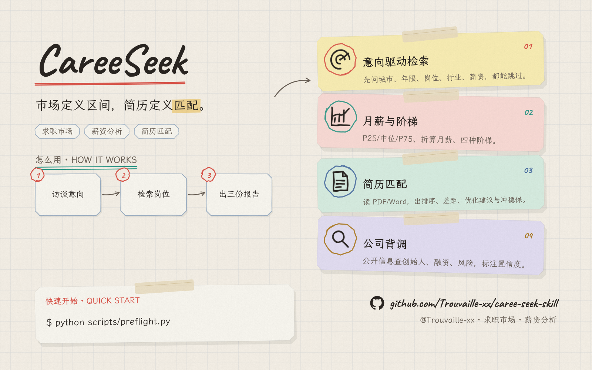
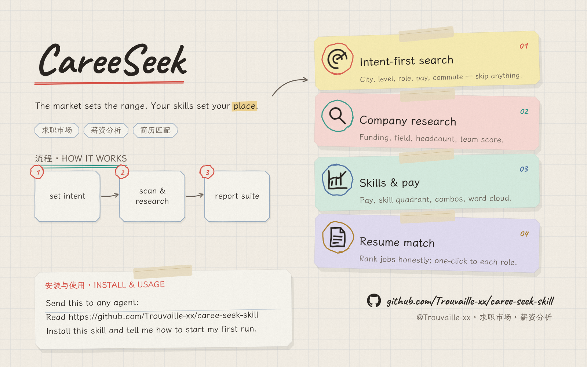

<p align="center">
  
</p>

<h1 align="center">CareeSeek</h1>

<p align="center">
  把招聘网站上的岗位，变成一份可决策的求职报告。<br>
  Turn job listings into decision-ready career reports.
</p>

<p align="center">
  <a href="https://github.com/Trouvaille-xx/caree-seek-skill">github.com/Trouvaille-xx/caree-seek-skill</a>
</p>

<p align="center">
  
  
  
  
</p>

<p align="center">
  <a href="#chinese">简体中文</a> · <a href="#english">English</a> · <a href="SKILL.md">SKILL.md</a>
</p>

> **个人求职研究工具**：只做检索与分析，不自动投递、不自动沟通；遇到验证码会暂停由你手动处理。详见 [references/compliance.md](references/compliance.md)。
>
> **For personal research only.** No auto-apply or auto-messaging. Pauses on captcha for manual handling.

---

<a id="chinese"></a>
## 简体中文

### 这是什么

CareeSeek 是一个可安装到 Claude Code、Codex、DeepSeek 等 agent harness 的求职市场情报 skill。它复用你已登录的浏览器，在 Boss直聘 按求职意向检索岗位，产出三件套：

| 交付物 | 内容 |
|---|---|
| **汇总 Excel** | 岗位 JD 明细 / 公司与创始人 / 统计分析 / JD 全文速览 / 创始人背景明细 / 简历匹配结果 |
| **岗位 seek 报告** | ECharts 图先行 + 结论紧随：薪资结构、分层驱动、技能与 JD、公司与创始人、可筛选岗位总表 |
| **简历匹配报告** | 匹配排序、技能差距、简历优化建议、冲 / 稳 / 保投递分档 |

核心原则：**浏览器操作由宿主 agent 完成，脚本只处理数据**——因此能跨 harness 分发。

### 核心能力

- **意向驱动**：先问城市、年限、目标岗位、行业、薪资；全部可跳过，有默认值。
- **月薪口径**：P25 / 中位 / P75、折算月薪、报价模板频次、区间宽度；不做 KDE 伪平滑。
- **四种阶梯**：同司职级对比、跨司对标、能力技能地图、薪资曲线。
- **公司背调**：公开信息查创始人 / 融资 / 规模 / 风险，带置信度与同名消歧。
- **简历匹配**：支持 PDF / Word / Markdown / 文本，输出排序、差距、优化建议、冲稳保。
- **跨 harness**：SKILL.md + Python 标准库；浏览器工具自动探测（ego-browser → Claude-in-Chrome → Playwright MCP → tabbit）。
- **断点续跑**：append-only 数据 + 状态机，中断不丢进度。
- **ECharts 离线内嵌**：报告单文件、零 CDN、断网可看。

### 快速开始

```bash
# 环境自检
python scripts/preflight.py

# 意向配置（示例答案）
python scripts/intake.py --answers answers.json

# 采集：agent 通过浏览器工具抽取后入库
python scripts/ingest.py --run runs/<id> --kind jobs --file batch.json --extraction-mode card_only

# 分析 + 双报告 + 导出
python scripts/normalize.py --run runs/<id>
python scripts/analyze.py   --run runs/<id>
python scripts/report.py    --run runs/<id>
python scripts/export.py    --run runs/<id> --format all
```

已有调研 Excel 可以直接导入：

```bash
python scripts/import_xlsx.py --run runs/<id> --xlsx "调研.xlsx"
```

离线演示（无需联网）：

```bash
python scripts/make_fixtures.py --run runs/demo
python scripts/normalize.py --run runs/demo && python scripts/analyze.py --run runs/demo
python scripts/report.py --run runs/demo && python scripts/export.py --run runs/demo --format all
```

### 示例数据（Mock）

> 以下均为演示数据，**公司名统一以 `xxxxx` 脱敏**，不是真实招聘信息。

**薪资基准**

| 指标 | 数值 |
|---|---|
| 有效岗位样本 | 126 |
| 月薪 P25 / 中位 / P75 | 18.9K / 22.5K / 35.0K |
| 折算月薪中位 | 26.1K（+16.1%） |
| 超过 12 薪 | 48.4% |
| 岗位数 / 公司数 | 127 / 113 |
| 查到创始人姓名 | 57 / 113 |

**岗位样例**（匹配分基于示例简历）

| 岗位 | 公司 | 城市 | 月薪中位 | 经验 | 匹配分 |
|---|---|---|---|---|---|
| AI产品经理 | xxxxx科技 | 上海·徐汇 | 22.5K | 1-3年 | 93.5 |
| 大模型产品经理 | xxxxx集团 | 上海·浦东 | 30.0K | 经验不限 | 87.2 |
| AI应用产品经理 | xxxxx信息 | 上海·杨浦 | 20.0K | 1-3年 | 81.4 |
| 数据产品经理 | xxxxx网络 | 上海·黄浦 | 35.0K | 3-5年 | 74.8 |
| AI产品专员 | xxxxx数据 | 上海·静安 | 13.2K | 1-3年 | 58.9 |

**高频技能（JD 命中岗位数）**

| 技能 | 命中 |
|---|---|
| 大模型 | 77 |
| Agent / 智能体 | 76 |
| 数据分析 | 44 |
| Prompt | 41 |
| RAG | 37 |
| 需求分析 | 35 |

**简历匹配 Top 3**

| 排名 | 岗位 | 公司 | 匹配分 | 缺失技能 |
|---|---|---|---|---|
| 1 | AI产品经理 | xxxxx科技 | 93.5 | — |
| 2 | 大模型产品经理 | xxxxx集团 | 87.2 | 多模态 |
| 3 | AI应用产品经理 | xxxxx信息 | 81.4 | AIGC、多模态 |

### 报告结构（金字塔）

1. **结论速览**：KPI + 5–8 条核心结论
2. **薪资结构**：直方图、报价模板、分位数、薪数、月薪 vs 折算
3. **分层驱动**：融资、规模、区域、招聘量 Top 公司、脱敏对比
4. **技能与 JD**：高频技能、技能溢价、标题细分、JD 字数
5. **公司与创始人**：置信度环图 + 背调卡片
6. **岗位总表**：可排序 / 筛选
7. **附录**：数据质量、方法口径、合规声明

### 目录结构

```
caree-seek-skill/
├── SKILL.md                # skill 入口与硬规则
├── README.md
├── references/             # 浏览器契约、playbook、反风控、问卷、背调、合规
├── schema/                 # intake / job / company / analysis / resume / match
├── scripts/                # preflight / intake / ingest / normalize / analyze / match / report / export / import_xlsx
├── templates/              # seek 报告、简历匹配报告、默认配置
├── assets/                 # echarts.min.js、showpage 海报
└── runs/<id>/              # 每次运行的工作区（git 已排除）
```

### 安装

- **Claude Code**：把目录放到 `~/.claude/skills/caree-seek/` 或项目内 `.claude/skills/caree-seek/`
- **Codex / 其他 harness**：放到其 skill 约定目录；若不支持 SKILL.md，按 `SKILL.md` 作为操作手册执行
- 浏览器工具与 Web 搜索按 [references/browser-contract.md](references/browser-contract.md) 适配

### 隐私与合规

- 仅用于个人求职研究；不自动投递、不自动打招呼。
- 不绕过验证码 / 登录墙；遇到即暂停，由你手动完成。
- 背调仅基于公开信息，风险项均为「待核实」线索。
- 仓库不包含任何采集数据与真实简历；`runs/` 已加入 `.gitignore`。
- 示例数据中的公司名统一脱敏为 `xxxxx`。

---

<a id="english"></a>
## English

<p align="center">
  
</p>

### What it is

CareeSeek is an agent-agnostic job-market intelligence skill for Claude Code, Codex, DeepSeek, and other harnesses. It reuses your logged-in browser to scan job postings on Boss直聘 and delivers three artifacts:

| Artifact | Contents |
|---|---|
| **Summary Excel** | Job details, companies & founders, statistics, full JD index, founder profiles, resume-match results |
| **Job seek report** | ECharts-first HTML: pay structure, segment drivers, skills & JDs, company checks, filterable job table |
| **Resume match report** | Ranking, skill gaps, resume fixes, and reach / target / safety application tiers |

The core split: **the host agent drives the browser; scripts only process data** — that is what makes it portable across harnesses.

### Highlights

- **Intent-first**: city, years, role, industry, and pay are asked up front — all skippable with defaults.
- **Monthly pay as the primary metric**: P25 / median / P75, annualized monthly pay, quote-template frequency, interval width — no fake smoothing.
- **Four ladder views**: same-company levels, cross-company mapping, capability map, salary curve.
- **Company checks**: public-source founder / funding / size / risk signals with confidence and name disambiguation.
- **Resume matching**: PDF / Word / Markdown / text → ranking, gaps, rewrite suggestions, reach/target/safety tiers.
- **Harness-agnostic**: SKILL.md + Python standard library; browser tools auto-probed (ego-browser → Claude-in-Chrome → Playwright MCP → tabbit).
- **Resumable**: append-only data + state machine.
- **Offline ECharts**: single-file reports, no CDN, readable without network.

### Quick start

```bash
python scripts/preflight.py
python scripts/intake.py --answers answers.json
python scripts/ingest.py --run runs/<id> --kind jobs --file batch.json --extraction-mode card_only
python scripts/normalize.py --run runs/<id>
python scripts/analyze.py   --run runs/<id>
python scripts/report.py    --run runs/<id>
python scripts/export.py    --run runs/<id> --format all
```

Import an existing research workbook:

```bash
python scripts/import_xlsx.py --run runs/<id> --xlsx "research.xlsx"
```

Offline demo:

```bash
python scripts/make_fixtures.py --run runs/demo
python scripts/normalize.py --run runs/demo && python scripts/analyze.py --run runs/demo
python scripts/report.py --run runs/demo && python scripts/export.py --run runs/demo --format all
```

### Mock data

> All data below is illustrative. **Company names are masked as `xxxxx`** and are not real postings.

**Pay benchmark**

| Metric | Value |
|---|---|
| Valid postings | 126 |
| Monthly pay P25 / median / P75 | 18.9K / 22.5K / 35.0K |
| Annualized monthly pay (median) | 26.1K (+16.1%) |
| Postings with >12 months | 48.4% |
| Postings / companies | 127 / 113 |
| Companies with founder name | 57 / 113 |

**Sample postings**

| Role | Company | City | Monthly mid | Experience | Match |
|---|---|---|---|---|---|
| AI Product Manager | xxxxx Tech | Shanghai · Xuhui | 22.5K | 1–3 yrs | 93.5 |
| LLM Product Manager | xxxxx Group | Shanghai · Pudong | 30.0K | Any | 87.2 |
| AI Application PM | xxxxx Info | Shanghai · Yangpu | 20.0K | 1–3 yrs | 81.4 |
| Data Product Manager | xxxxx Network | Shanghai · Huangpu | 35.0K | 3–5 yrs | 74.8 |
| AI Product Specialist | xxxxx Data | Shanghai · Jing'an | 13.2K | 1–3 yrs | 58.9 |

**Top skills (postings mentioning)**

| Skill | Postings |
|---|---|
| LLM / 大模型 | 77 |
| Agent | 76 |
| Data analysis | 44 |
| Prompt | 41 |
| RAG | 37 |
| Requirements analysis | 35 |

**Resume match — top 3**

| Rank | Role | Company | Match | Missing skills |
|---|---|---|---|---|
| 1 | AI Product Manager | xxxxx Tech | 93.5 | — |
| 2 | LLM Product Manager | xxxxx Group | 87.2 | Multimodal |
| 3 | AI Application PM | xxxxx Info | 81.4 | AIGC, Multimodal |

### Report structure (pyramid)

1. **Executive summary**: KPIs + 5–8 conclusions
2. **Pay structure**: histogram, quote templates, quantiles, months, monthly vs annualized
3. **Segment drivers**: funding, size, district, top employers, desensitized comparison
4. **Skills & JDs**: frequency, salary lift, title segments, JD length
5. **Companies & founders**: confidence donut + check cards
6. **Job table**: sortable / filterable
7. **Appendix**: data quality, methodology, compliance

### Install

- **Claude Code**: drop the folder into `~/.claude/skills/caree-seek/` or `.claude/skills/caree-seek/`
- **Codex / other harnesses**: place it in the harness's skill directory; if SKILL.md is unsupported, follow it as an operating manual
- Browser and web-search tooling follow [references/browser-contract.md](references/browser-contract.md)

### Privacy & compliance

- Personal job-market research only; no auto-apply or auto-messaging.
- Never bypasses captchas or login walls; pauses for manual handling.
- Company checks use public sources; risk items are unverified leads.
- No scraped data or real resumes are committed; `runs/` is git-ignored.
- All company names in mock data are masked as `xxxxx`.

---

## License

No license file is included yet. Add one before redistributing.
